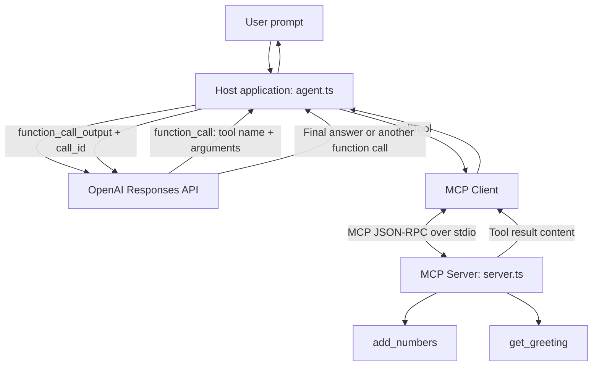

# MCP Tool Explorer

**An end-to-end MCP-powered AI agent built with TypeScript and the OpenAI SDK.** Learn how an AI host launches a local MCP server, discovers tools, lets an LLM choose functions, executes those functions through an MCP client, and returns their results to the model for a final answer.

> **Learning project:** Four incremental milestones, from MCP tool discovery to a complete LLM-driven tool-calling loop.

## What you'll learn

- The responsibilities of an **MCP host**, **MCP client**, and **MCP server**.
- How to start a local MCP server as a child process using **stdio**.
- How to discover available tools using `listTools()`.
- How to call tools explicitly using `callTool()` and interpret MCP `content` blocks.
- How to convert MCP tool definitions to OpenAI function definitions.
- How to handle `function_call` and `function_call_output` with the OpenAI Responses API.
- How to process multiple tool calls, report errors, and limit agent execution rounds.

## Tech stack

| Technology | Purpose |
| --- | --- |
| TypeScript + Node.js | Host, MCP client, and MCP server |
| Official MCP TypeScript SDK v2 | MCP server, client, and stdio transport |
| OpenAI Node.js SDK | Model inference and function calling |
| Zod | Define and validate MCP tool arguments |
| tsx | Run TypeScript files without a separate build step |
| dotenv | Load `OPENAI_API_KEY` from `.env` |

## Architecture



**Role separation:**

- **Host:** Orchestrates the conversation, the OpenAI model, tool permissions, and the MCP client.
- **MCP client:** Connects to an MCP server, discovers tools, and sends tool requests.
- **MCP server:** Registers tools and executes their implementations.
- **OpenAI model:** Chooses a function and proposes arguments; it does **not** directly execute local MCP tools.

## Project structure

```text
mcp-tool-explorer/
├── src/
│   ├── server.ts         # MCP server with example tools
│   ├── client.ts         # Milestones 1–2: discover and manually call tools
│   ├── openai-mcp.ts     # Milestone 3: let OpenAI select a tool
│   └── agent.ts          # Milestone 4: complete tool-calling loop
├── .env                  # Local API key (do not commit)
├── .gitignore
├── package.json
├── tsconfig.json
└── README.md
```

## Prerequisites

- Node.js **20 or later** and npm.
- An OpenAI API key with API billing enabled and access to your chosen model (required for Milestones 3–4 only).

## Getting started

### 1. Clone and install

```bash
git clone <YOUR_REPOSITORY_URL>
cd mcp-tool-explorer
npm install
```

If starting the project from scratch instead of cloning:

```bash
npm init -y
npm pkg set type=module
npm install openai @modelcontextprotocol/client @modelcontextprotocol/server zod dotenv
npm install -D typescript tsx @types/node
```

This project uses **MCP SDK v2** (`@modelcontextprotocol/client` and `@modelcontextprotocol/server`), not the older v1 `@modelcontextprotocol/sdk` package.

### 2. Configure your API key

Create `.env` in the project root:

```dotenv
OPENAI_API_KEY=your_openai_api_key
```

Ensure `.gitignore` contains:

```gitignore
node_modules/
.env
```

**Security:** Never commit API keys or other secrets. Milestones 1–2 don't make OpenAI API calls and can run without an API key if your local client code doesn't instantiate the OpenAI SDK.

### 3. Add scripts

The following scripts match the milestone files:

```bash
npm pkg set scripts.start="tsx src/client.ts"
npm pkg set scripts.milestone3="tsx src/openai-mcp.ts"
npm pkg set scripts.milestone4="tsx src/agent.ts"
```

## Milestones

### Milestone 1 — MCP connection and tool discovery

**Goal:** Spawn a local MCP server, discover its advertised tools, and print their details.

```bash
npm start
```

Core MCP client operations:

```typescript
await client.connect(transport);
const { tools } = await client.listTools();
console.log(tools);
```

The `StdioClientTransport` starts the server as a child process. Its standard input/output streams carry MCP messages; use `console.error()` rather than `console.log()` inside the stdio server for diagnostics.

### Milestone 2 — Manually execute tools

**Goal:** Invoke a specific tool through the MCP client without asking the model to select it.

```typescript
const result = await client.callTool({
  name: "add_numbers",
  arguments: { a: 10, b: 20 },
});

console.log(JSON.stringify(result, null, 2));
```

An example MCP result is:

```json
{
  "content": [
    { "type": "text", "text": "30" }
  ]
}
```

The `content` array is **part of the MCP tool result format**, not an application-specific property. A tool can also return structured data via `structuredContent` when appropriate. Check `isError` when handling failed tool executions.

### Milestone 3 — Expose MCP tools to OpenAI

**Goal:** Fetch MCP tool metadata, adapt it to OpenAI function definitions, and inspect the model's requested function call.

```bash
npm run milestone3
```

Core mapping:

```typescript
const { tools: mcpTools } = await mcpClient.listTools();

const openaiTools = mcpTools.map((tool) => ({
  type: "function" as const,
  name: tool.name,
  description: tool.description ?? "",
  parameters: tool.inputSchema,
  strict: false,
}));
```

Send `openaiTools` to `openai.responses.create({ ... })`. A `function_call` response contains the **name**, JSON-encoded **arguments**, and **call_id**. It does not mean that the function has been executed yet.

### Milestone 4 — End-to-end agent tool execution

**Goal:** Execute model-requested tools on the MCP server and return their results to the model.

```bash
npm run milestone4
```

Example request: **“What is 125 plus 375?”**

```text
1. Host sends user prompt + MCP tool definitions to OpenAI
2. Model requests add_numbers({ "a": 125, "b": 375 })
3. Host checks the tool is allowed and parses the arguments
4. MCP client calls the MCP server using callTool()
5. MCP server computes the result and returns content: "500"
6. Host sends function_call_output with the original call_id
7. Model returns a final answer, e.g. "125 + 375 = 500"
```

Essential pattern:

```typescript
const functionCalls = response.output.filter(
  (item) => item.type === "function_call"
);

for (const call of functionCalls) {
  const result = await mcpClient.callTool({
    name: call.name,
    arguments: JSON.parse(call.arguments),
  });

  toolOutputs.push({
    type: "function_call_output",
    call_id: call.call_id,
    output: JSON.stringify(result),
  });
}

response = await openai.responses.create({
  model: MODEL,
  previous_response_id: response.id,
  input: toolOutputs,
  tools: openaiTools,
});
```

> This is a **conceptual excerpt** from the full loop. See `src/agent.ts` for the allowlist, error handling, maximum-round limit, and completion logic.

**Why the loop eventually stops:** `functionCalls.length` does not decrement automatically. Each call to the Responses API creates a **new** `response`, and each loop iteration filters **that new response**. When the model returns a normal message without a `function_call`, the array is empty and the host stops. A maximum-round limit prevents indefinite calls.

## Example MCP tools

| Tool | Input | Example output |
| --- | --- | --- |
| `add_numbers` | `{ "a": 125, "b": 375 }` | `500` |
| `get_greeting` | `{ "name": "Alex" }` | `Hello Alex!` |

Tools are registered in `src/server.ts` using `server.registerTool(...)` and Zod `inputSchema` definitions.

## Model choice and API cost

Set the `MODEL` constant in `src/openai-mcp.ts` and `src/agent.ts` to an **available, lower-cost model that supports function calling**. Check the [OpenAI models documentation](https://platform.openai.com/docs/models) and [API pricing](https://openai.com/api/pricing/) for current options and rates.

For inexpensive experiments:

- Keep the prompt short.
- Send only the relevant tool definitions.
- Use `tool_choice: "auto"` unless testing forced tool selection.
- Set a reasonable `max_output_tokens` limit; allow enough for model output and any reasoning tokens.
- Limit tool rounds (the example uses `MAX_TOOL_ROUNDS = 3`).

**Note:** The end-to-end flow generally requires more than one billable OpenAI API request: one to select a tool and another to process the tool output. Model availability, prices, and deprecations can change.

## Troubleshooting

| Symptom | What to check |
| --- | --- |
| Client cannot spawn server | `npx`, `tsx`, working directory, and `src/server.ts` path |
| JSON-RPC parse error | Avoid writing debug logs to the MCP server's stdout |
| `OPENAI_API_KEY` missing | Check `.env` and `import "dotenv/config"` |
| Model not found / access error | Use a model available to your API project |
| No `function_call` returned | With `tool_choice: "auto"`, the model may answer without tools |
| Tool input validation fails | Match the Zod `inputSchema`, including number vs. string types |
| Agent keeps calling tools | Inspect tool results, cap execution rounds, and verify the returned `call_id` |

## Roadmap

- [x] Discover MCP tools from a spawned stdio server.
- [x] Execute MCP tools manually.
- [x] Expose MCP tools to an OpenAI model.
- [x] Complete the OpenAI → MCP tool → OpenAI response loop.
- [ ] Integrate a real-world server such as Playwright MCP.
- [ ] Add approval/permission checks for sensitive tool actions.
- [ ] Add automated tests, logging, and observability.

## References

- [Model Context Protocol](https://modelcontextprotocol.io/)
- [MCP TypeScript SDK v2 — First Client](https://ts.sdk.modelcontextprotocol.io/v2/get-started/first-client.html)
- [MCP TypeScript SDK v2 — First Server](https://ts.sdk.modelcontextprotocol.io/v2/get-started/first-server.html)
- [OpenAI Function Calling](https://platform.openai.com/docs/guides/function-calling)
- [OpenAI Responses API](https://platform.openai.com/docs/api-reference/responses)

---

Built as a hands-on learning project to understand MCP from **tool discovery to end-to-end agent execution**.
